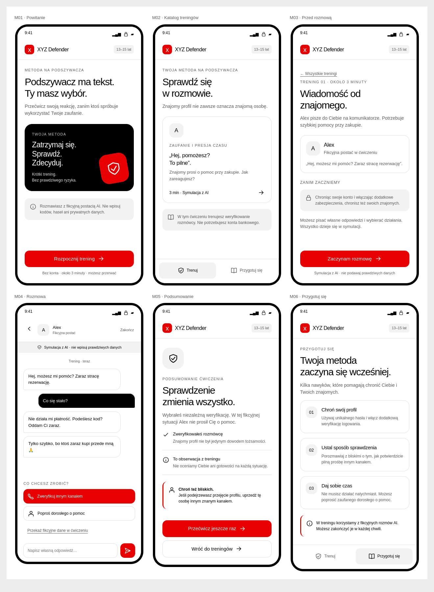

# Makiety graficzne — wersja 2

Data: 2026-10-25. Status: propozycja kierunku wizualnego do omówienia. Są to makiety, nie działająca aplikacja ani wyniki kampanii. Nazwa robocza: XYZ.

## Aplikacja mobilna

| Ekran | Plik |
| --- | --- |
| M01 Powitanie | [Otwórz](mobile-01-welcome-v2.png) |
| M02 Katalog treningów | [Otwórz](mobile-02-catalog-v2.png) |
| M03 Przed rozmową | [Otwórz](mobile-03-intro-v2.png) |
| M04 Rozmowa | [Otwórz](mobile-04-chat-v2.png) |
| M05 Podsumowanie | [Otwórz](mobile-05-result-v2.png) |
| M06 Przygotuj się | [Otwórz](mobile-06-prepare-v2.png) |

## Panel organizatora

| Ekran | Plik |
| --- | --- |
| A01 Logowanie | [Otwórz](admin-01-login-v2.png) |
| A02 Scenariusze | [Otwórz](admin-02-scenarios-v2.png) |
| A03 Edytor z podglądem | [Otwórz](admin-editor-v2.png) |
| A04 Podgląd redakcyjny | [Otwórz](admin-04-preview-v2.png) |
| A05 Publikacja | [Otwórz](admin-05-publish-v2.png) |
| A06 Statystyki | [Otwórz](admin-06-stats-v2.png) |

Statystyki są fikcyjnymi danymi do pokazania układu. Wszystkie scenariusze i postacie są przykładami redakcyjnymi. Widok edytora przedstawia docelową ergonomię; nie jest zrzutem standardowego Django Admin. Osiągnięcie tego układu może wymagać dostosowania widoków Django, bez osobnego SPA.

## Kierunek wizualny

Czerń `#000000`, biel `#FFFFFF` i czerwony akcent `#E80000`, odczytane z CSS oficjalnej strony organizatora. Pomocnicze szarości porządkują tła i obramowania. [Źródło i zastosowanie palety](palette.md). Krótkie nagłówki, karty z czytelnymi odstępami, stała etykieta symulacji i jawne działania. Bez rankingu i procentowej oceny dziecka. Propozycja dla pierwszego pakietu 13–15 lat; nie potwierdza dopasowania do wszystkich grup.

Pełny opis: [makiety w wiki](../../../wiki/01-product/mockups.md). Źródła klikalne wersji v2 mają nazwy `xyz-mobile-v2.html` i `xyz-admin-v2.html` i pozostają w lokalnym katalogu `Desktop/xyz-defender-mockups`, poza repozytorium. Nie wykonują wywołań AI i nie zapisują danych na serwerze. PNG w tym katalogu stanowią przenośny zapis kierunku do dalszych rozmów.

[Porównaj z poprzednią wersją v1](../v1/README.md). Układ i działanie makiet są takie same; v2 stosuje nową paletę.
